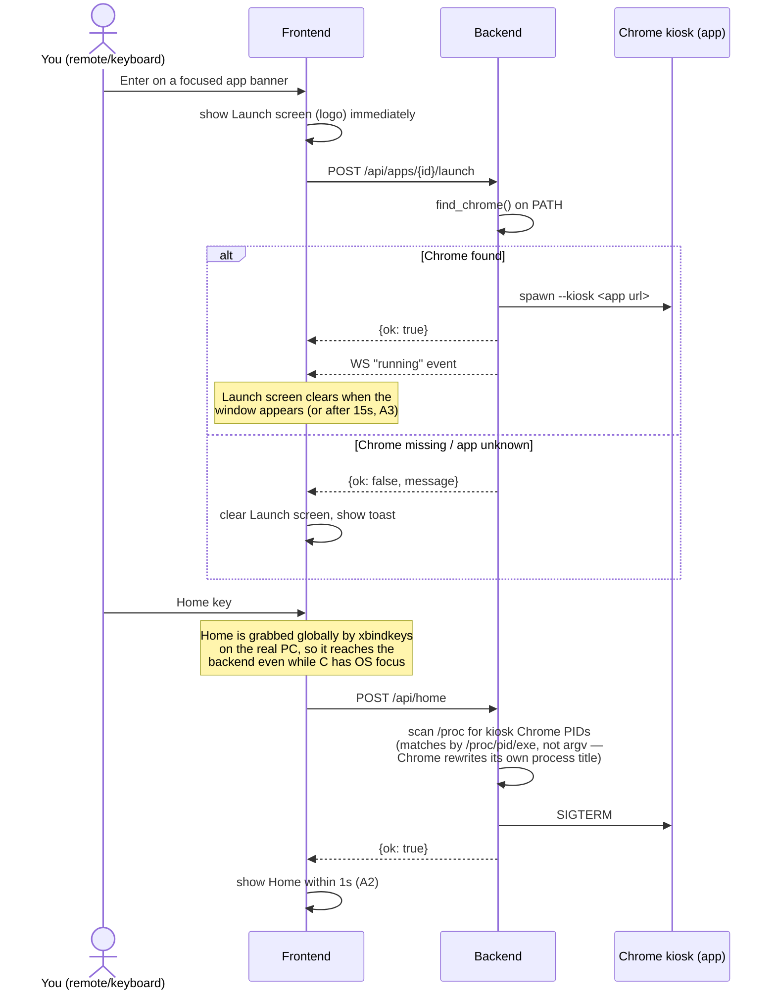

# App launch / close sequence

What happens when you press Enter on a banner, and when you press Home to
close it — the PRD's A2/A3 requirements (`backend/tv_home/chrome.py`,
`frontend/src/state/nav.ts`).

