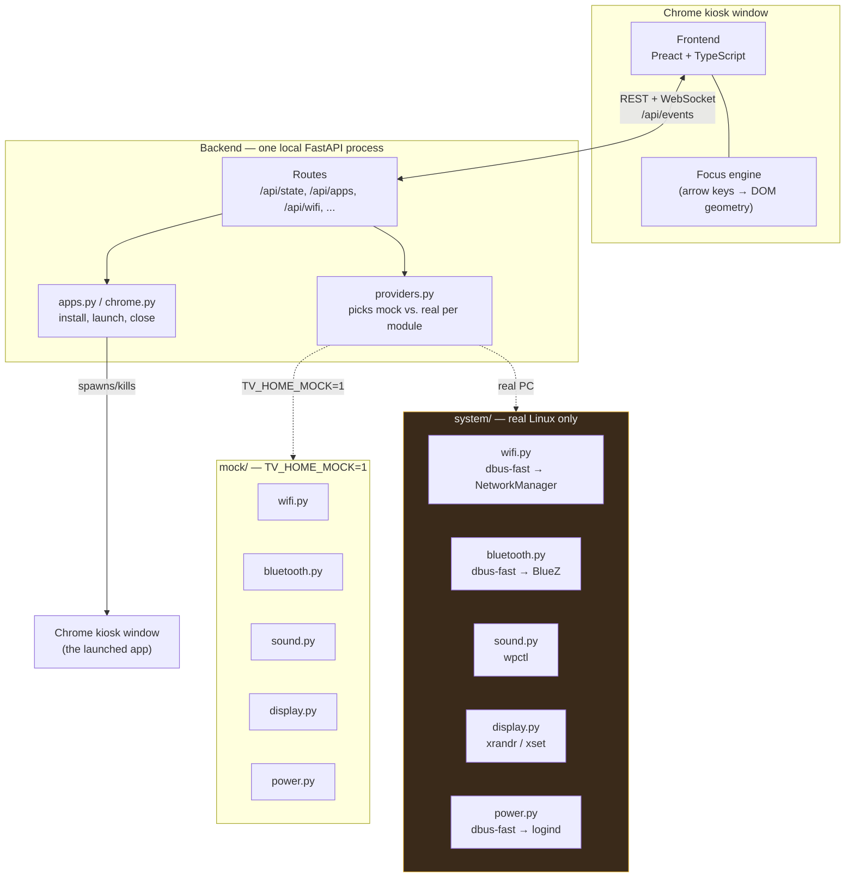

# Architecture diagram

Companion to `docs/ARCHITECTURE.md` §2. The frontend only ever talks to the
backend's REST/WS API — it never knows whether `mock/` or `system/` is behind
it.

Orange = written to spec but unverified in this dev environment (no D-Bus,
NetworkManager, BlueZ, PipeWire or X11 on macOS) — see each module's own
header comment and `docs/TODO.md`.
