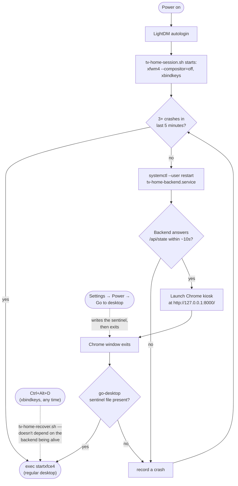

# Boot and recovery flow

What happens from power-on to Home, and the paths back to the regular
desktop — `session/tv-home-session.sh`. **Unverified**: this only runs on the
real Xubuntu PC (LightDM, X11, systemd); see `session/README.md`.

Three independent paths reach the desktop: the crash counter (Y2), the
sentinel file a normal "Go to desktop" action writes, and Ctrl+Alt+D's
recovery script, which is deliberately self-contained so it still works if
the backend has crashed outright (Y3).
